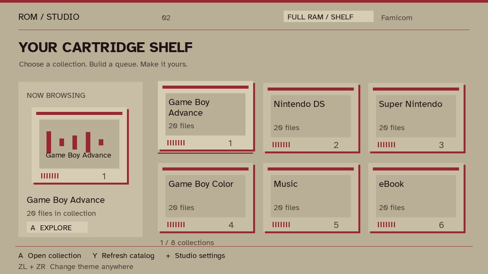
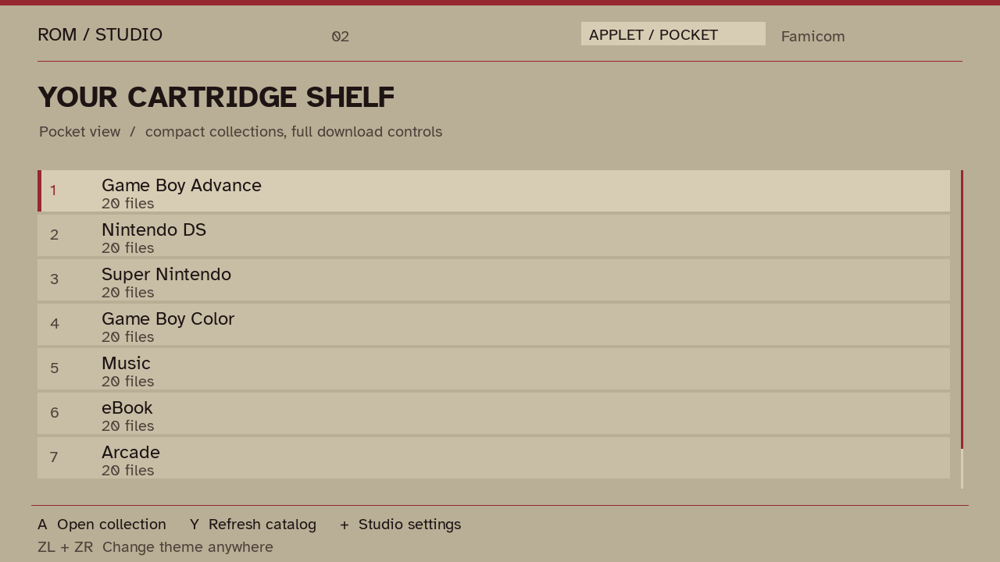

# ROM Downloader 2.0 — ROM / Studio

A Nintendo Switch homebrew downloader with a cartridge-inspired interface, live console palettes, and a background download queue. The interface was designed specifically for this app.

## Two interfaces

**Full RAM / Shelf:** six cartridge tiles per page, collection artwork or a procedural label, a file inspector, and a large transfer dashboard.

**Applet / Pocket:** a full-width collection list, full-width file selection and transfer screens, no cover textures, an 80-entry text cache (220 in full mode), and a 4 MiB catalog response limit (24 MiB in full mode). Both modes support the same download workflow. Layout is selected automatically from the libnx applet type.




## What's new

- Twelve live console palettes, animated palette transitions, sliding screen entrances, eased focus movement, animated cartridge focus, scrolling long filenames, and smooth download bars. Reduced motion is available.
- Readable Atkinson Hyperlegible typography, clipped text, selection counts, contextual controls, visible scrollbars, and clear empty/error states.
- Search within a collection, favorites, favorites filtering, alphabetical sorting, page navigation, select-visible/deselect-visible, and selections retained across collections.
- Review the whole queue before starting; remove individual items, choose an SD folder, create folders, or pick from the last 12 destinations.
- Background catalog loading and downloads. No artificial loading delay. Cached catalogs work offline; a failed update retains the usable cached catalog.
- Download percentage, byte counts, transfer speed, estimated time remaining, pause/resume, confirmed cancellation, per-file results, and retry for failed/cancelled downloads.
- Files download to unique temporary paths and are committed after success. Existing files are skipped. Cancellation removes the active partial file and keeps completed files.
- Optional ZIP extraction with progress, pause/cancel, entry-path validation, CRC/size checking, and preservation of existing files. Choose Off, Extract + keep ZIP, or Extract + delete ZIP in Settings or with Y on the review screen. Delete mode removes the original only after every file has been successfully extracted and verified. Errors, cancellation, empty archives, or skipped existing files keep the ZIP. Arcade archives remain packed and are never deleted.
- Preferences, favorites, and recent paths persist. The previous settings/history/cache files are read for migration; new preferences live in `sdmc:/switch/ROM_Downloader/studio.json`.

## Controls

| Screen | Controls |
| --- | --- |
| Everywhere | ZL + ZR: cycle theme. +: settings while browsing. |
| Shelf | D-pad / left stick: navigate. A: open. Y: refresh. B: settings. |
| Files | A: toggle selection. X: queue/destination. Y: search (clear the query for all files). L: favorites filter. R: sort direction. R-stick click: favorite. Minus: select/deselect visible results. ZL/ZR: page. B: shelf. |
| Folder | A: open. L: parent. R: create folder. Y: recent paths. X: review. B: files. |
| Recent paths | A: use. B: folder browser. |
| Review | A: start. X: remove focused item. Y: cycle extraction mode (off / keep ZIP / delete ZIP). B: destination. |
| Download / extraction | A: pause/resume. B: stop confirmation; A confirms, B returns to the previous pause state. |
| Results | A/B: files. X: retry failed/cancelled downloads. |
| Settings | A: change/activate. Left/Right: cycle the focused palette. B: back, preserving the prior cursor. Exit is the last row. |

Selections can span collections. All selected files use the chosen destination. If two selected items have the same output filename, the first successful save wins and the later file is skipped. No existing file is replaced.

## Build

Use devkitPro/devkitA64, libnx, Switch SDL2/SDL2_image/SDL2_ttf/SDL2_mixer, curl, and minizip portlibs. The existing audio/image dependencies remain listed in `Makefile`.

```sh
export DEVKITPRO=/opt/devkitpro
export DEVKITA64=$DEVKITPRO/devkitA64
make -j2
```

Copy `ROM_Downloader.nro` to your Switch homebrew folder. RomFS embeds fonts and sounds.

## Code map

| File | Responsibility |
| --- | --- |
| `source/main.cpp` | Platform initialization, frame loop, shutdown |
| `include/app.hpp` | Screens, preferences, queue, and shared application interfaces |
| `source/model.cpp` / `include/model.hpp` | Portable catalog parser, filtering, path validation, formatting |
| `source/input.cpp` | Controller mappings and workflow transitions |
| `source/storage.cpp` | Preferences/migration, SD folder browser, keyboard, destination history |
| `source/worker.cpp` | Background catalog/download worker, ZIP extraction, synchronized progress |
| `source/ui.cpp` | Cartridge layouts, screen rendering, bounded text/artwork caches, animation |
| `source/themes.h` | Twelve existing console palettes |

The worker owns its task copies and never touches SDL textures or live UI state. It publishes progress through a mutex and uses atomic pause/cancel flags. The UI thread joins finished workers before consuming their results.

## Tests and previews

`tests/model_tests.cpp` exercises catalog JSON, malformed records, duplicate filenames, search/favorites/sorting, SD paths, archive paths, and large byte sizes. Build with a desktop C++17 compiler:

```sh
c++ -std=c++17 -Iinclude tests/model_tests.cpp source/model.cpp -o model_tests
./model_tests
```

`tests/desktop_preview.cpp` links the production renderer and input module with desktop SDL2, SDL2_ttf, SDL2_image, SDL2_mixer and `tests/stubs/switch.h`. It uses synthetic catalog records, tests selection/search/favorites/queue/pause/cancel, renders all 12 themes, and writes PNGs under `build/`. It does not contact download servers. `tests/run-desktop.ps1` documents and automates the Windows version of these checks with a locally supplied Zig compiler and SDL DLLs.

The screenshots above come from that actual renderer, using synthetic data. Desktop tests do not replace Switch testing: check handheld/docked text, applet memory, keyboard return, long downloads, SD-full errors, ZIP failures, pause over 40 seconds, sleep/wake, and shutdown on hardware.

## Limits

- Pause resumes the current session; downloads do not resume across app restarts.
- ZIP extraction supports the installed minizip decoder. Password-protected archives, links, duplicate entry paths, unsafe paths, and archives above 20,000 entries are rejected. Other archive types are kept as downloads. Extraction warnings are shown in the saved file's result detail; retry applies to downloads, not extraction.
- Partial extraction can leave successfully completed extracted files; cancellation removes only the active temporary file. Existing extracted files are skipped.
- Cover art uses previously cached images in `covers/`; uncached collections get procedural cartridge labels. New artwork is not fetched during catalog startup.
- The catalog endpoint remains the project's existing endpoint. Downloads follow HTTPS redirects and retain certificate verification.

## Third-party notices

JSON parsing uses nlohmann/json; its MIT license is in `licenses/nlohmann-json-MIT.txt`. Atkinson Hyperlegible comes from the [Google Fonts distribution](https://github.com/google/fonts/tree/main/ofl/atkinsonhyperlegible); its SIL Open Font License is in `licenses/AtkinsonHyperlegible-OFL.txt`. Existing project fonts, sounds, and icon are retained.
